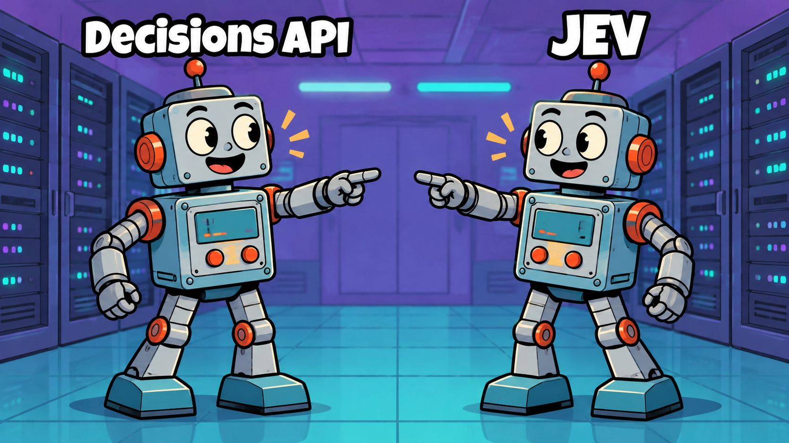

We were using GPT-6 Sol through the Responses API to make small decisions for our support bot. It would read a message and pick a support topic, or work out which action someone was asking for.

These calls only needed a choice from a list. When we looked at the prices for JEV and the Decisions API, the question was fairly obvious: could we do the same job for a lot less?

### A model for small decisions

Decision models handle narrow tasks: pick a category, check a condition, or give something a score. They return structured answers and probabilities that your code can use directly. Responses is more general-purpose; for our classifier, we asked it to generate JSON containing the answer and a confidence score.

We compared [JEV](https://docs.typesafe.ai/introduction), TypeSafe's System One model, with [OpenAI's Decisions API](https://developers.openai.com/api/docs/guides/decisions). We ran this experiment during the Decisions API's public beta, using GPT-6 Luna.

### The price difference got our attention

These are the public list prices per million tokens as of October 20, 2026. The input comparison uses uncached tokens and OpenAI's standard short-context pricing.

<table>
  <thead>
    <tr><th>API and model</th><th>Input per million tokens</th><th>Output per million tokens</th></tr>
  </thead>
  <tbody>
    <tr><td>Responses with GPT-6 Sol</td><td>$2.00</td><td>$10.00</td></tr>
    <tr><td>Responses with GPT-6 Luna</td><td>$0.10</td><td>$0.50</td></tr>
    <tr><td>JEV 1.13</td><td>$0.042</td><td>No charge</td></tr>
    <tr><td>Decisions with GPT-6 Luna</td><td>$0.10</td><td>No charge</td></tr>
  </tbody>
</table>

On input price, **JEV is 97.9% cheaper than SOL**, the model we were using, and **58% cheaper than Luna Responses**. **Decisions is 95% cheaper than SOL** and costs the same as Luna Responses for input. Both JEV and Decisions have no output-token charge.

Sources: [OpenAI model pricing](https://developers.openai.com/api/docs/pricing), [Decisions pricing](https://developers.openai.com/api/docs/guides/decisions#pricing-and-availability), and [JEV pricing](https://docs.typesafe.ai/models).

That was enough to get our attention. We needed to see what happened to the answers.

### What our bot needs to decide

I've written about [how we use OpsBot for engineering support](https://medium.com/agoda-engineering/how-agoda-is-evolving-engineering-support-with-ai-agents-c907a54e236e) before. For this experiment, we needed to classify a user's message and detect the action they were asking for. Think "I can't log in" → an access topic, or "assign this to me" → reassign the ticket.

### We ran evals

We used Luna for both Responses and Decisions, alongside JEV 1.13, so the two OpenAI endpoints used the same model. SOL was our production cost baseline; the results below compare against Luna Responses.

We ran 80 topic examples and 100 action examples through each API, keeping the task inputs and choices fixed. All 540 calls returned parseable answers. These were classification tests; we didn't execute ticket actions. Reference labels were AI-reviewed, and the sample deliberately included historical failures and unknown cases.

### Latency was the big win

**Both decision APIs brought p95 latency below a second for both tasks.**

<table>
  <thead>
    <tr><th>API</th><th>Action classification p95</th><th>Topic classification p95</th></tr>
  </thead>
  <tbody>
    <tr><td>Responses with Luna</td><td>3.313 s</td><td>5.483 s</td></tr>
    <tr><td>Decisions with Luna</td><td>0.478 s</td><td>0.652 s</td></tr>
    <tr><td>JEV 1.13</td><td>0.685 s</td><td>0.921 s</td></tr>
  </tbody>
</table>

Decisions was about **7 times faster for actions and 8 times faster for topics** at p95. JEV was about **5 to 6 times faster**.

Before you quote this as a "trust me bro" benchmark 😁: latency varies with context size, load, and model provider. Your numbers may differ, but our evals showed both decision APIs were substantially faster than Responses.

### Did they pick the right answer

First, we looked only at whether the selected answer matched an acceptable reference label. We ignored confidence for this part.

<table>
  <thead>
    <tr><th>API</th><th>Correct action matches</th><th>Correct topic matches</th></tr>
  </thead>
  <tbody>
    <tr><td>Responses with Luna</td><td>98/100</td><td>67/80</td></tr>
    <tr><td>Decisions with Luna</td><td>96/100</td><td>60/80</td></tr>
    <tr><td>JEV 1.13</td><td>95/100</td><td>64/80</td></tr>
  </tbody>
</table>

For actions, Decisions and JEV were close to Responses. Topics were harder for all three, and Responses still matched the most labels.

The speed improvement was clear, but we still had one more rule to apply: confidence. For Responses, that meant literally asking the LLM, "How confident are you?" Yes, we were using its answer to decide whether to accept its answer 😁. That rule had worked pretty well for us in production so far. Once we applied the same cutoff to all three APIs, the results looked different.

### The answer was correct but we rejected it

Our evaluation required an answer to match the expected label and have at least 80% confidence before counting it as correct and accepted.

Across both tasks:

<table>
  <thead>
    <tr><th>API</th><th>Correct matches without a cutoff</th><th>Correct and accepted at ≥80% confidence</th></tr>
  </thead>
  <tbody>
    <tr><td>Responses with Luna</td><td>165/180 (91.7%)</td><td>150/180 (83.3%)</td></tr>
    <tr><td>Decisions with Luna</td><td>156/180 (86.7%)</td><td>120/180 (66.7%)</td></tr>
    <tr><td>JEV 1.13</td><td>159/180 (88.3%)</td><td>131/180 (72.8%)</td></tr>
  </tbody>
</table>

At the 80% confidence cutoff, the correct-and-accepted rate dropped to **66.7% for Decisions** and **72.8% for JEV**.

### We tried threshold tuning first

We went back to the saved results and tried lower cutoffs. We looked for thresholds that accepted more correct answers without increasing the wrong answers passing compared with each API's own 80% baseline.

<table>
  <thead>
    <tr><th>Task</th><th>API</th><th>Cutoff change</th><th>Correct and accepted before → after</th><th>Wrong accepted before → after</th></tr>
  </thead>
  <tbody>
    <tr><td>Actions</td><td>Decisions</td><td>80% → 60%</td><td>71/100 → 89/100</td><td>0 → 0</td></tr>
    <tr><td>Actions</td><td>JEV</td><td>80% → 68%</td><td>89/100 → 93/100</td><td>2 → 2</td></tr>
    <tr><td>Topics</td><td>Decisions</td><td>80% → 75%</td><td>49/80 → 53/80</td><td>6 → 6</td></tr>
    <tr><td>Topics</td><td>JEV</td><td>80% → 78%</td><td>42/80 → 44/80</td><td>3 → 3</td></tr>
  </tbody>
</table>

At the tuned cutoffs, the correct-and-accepted rate rose to **78.9% for Decisions** and **76.1% for JEV**. We chose these cutoffs on the same examples, so they still need validation on unseen data.

### Confidence calibration

In simple terms: **if the confidence score is 80%, does that mean the answer is correct about 80% of the time?** That's what we'd want if we're treating the score as a probability of correctness.

[OpenAI's guidance](https://developers.openai.com/api/docs/guides/decisions#interpret-the-answers) recommends using labeled examples from your own application to set thresholds. Our tuning was a first step in understanding which scores we could use. We adjusted the cutoff; calibrating the scores would mean learning a mapping from those scores to observed correctness.

To do that, we'd compare scores with actual results, learn the mapping on one set, and check it on unseen examples. Scikit-learn explains [how to check calibration](https://scikit-learn.org/stable/modules/calibration.html#calibration-curves) and [how to calibrate a classifier](https://scikit-learn.org/stable/modules/calibration.html#calibrating-a-classifier).

I'm still new to this part of ML and learning as I go. We've tried threshold tuning so far; we haven't fitted or deployed a calibration mapping.

### Key takeaways

- For classification tasks like ours, decision-only models can be much cheaper and faster than generative models.

- These APIs may need tuning and customisation to fit an existing system. Our confidence cutoff was a good example.
