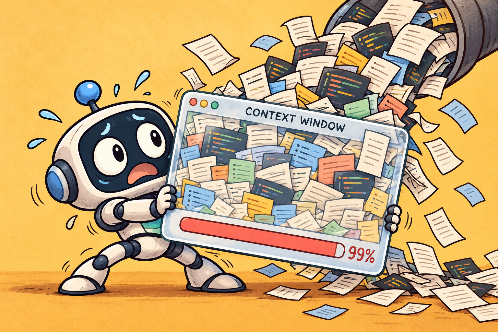

```text
Your input exceeds the context window of this model.
Please adjust your input and try again.
```

If you've read my [earlier post on engineering support at Agoda](https://medium.com/agoda-engineering/how-agoda-is-evolving-engineering-support-with-ai-agents-c907a54e236e), you know I'm on a team trying to reduce the time engineers spend handling support requests. We use domain agents to investigate issues and gather useful context before a person needs to step in.

Those agents run on our own agent loop. We call the model, execute the tools it asks for, send back the results, and keep going. We built this ourselves rather than using an agent SDK.

One big feature was missing: compaction. When an investigation ran for a while, the conversation kept growing until the agent stopped with the error above. It didn't affect every investigation, but having an agent give up halfway through helping someone was a problem we needed to solve.

Over the past month, we tried a different approach.



### We started with Pydantic AI

Our first attempt used [Pydantic AI Harness](https://pydantic.dev/docs/ai/harness/) with the [Monty sandbox](https://github.com/pydantic/monty). Monty gives code mode a local execution environment where the agent can process tool results in memory and return only what it needs.

Before taking this to beta users, we spent a few days evaluating it. When code mode was used, the context it passed back to the model wasn't good enough for our investigations. The resulting answers weren't matching what we expected. That made us hesitate to launch it.

Meanwhile, one of our engineers put together another option: a V2 of our existing harness, with the OpenAI Agents SDK handling the agent loop. It kept the same API contract for callers, so we could switch selected traffic to it without changing how our assistants were called.

The SDK used the Responses API and offered [automatic compaction](https://developers.openai.com/api/docs/guides/deployment-checklist#leverage-compaction). That addressed the feature we were missing, and the integration was more straightforward. We set the threshold to 70% of the context window in our integration code and started the experiment.

### Then the same error came back

We ran the pilot for about 15 days. Initially it helped, but we weren't seeing a clear overall reliability improvement over the legacy loop.

Across the five support channels we reviewed, we had a **19.1% failure rate**, with **2% of all invocations still hitting context limits despite compaction**.

We had compaction enabled. Why were we still sending requests larger than the model could accept?

Looking at the investigations made the missing piece easier to see. Our Tempo MCP returns traces, and those traces can be huge. Some domain MCPs also return a lot of data. We had an investigation where a Tempo response alone was around **12 MB**.

Imagine the conversation is already using 60% of the context window. The next tool call brings back a huge trace and pushes it beyond the limit. Without reducing that result first, the next model request can fail before the model gets a chance to use it. Having a compaction threshold doesn't by itself protect that boundary.

Lowering the threshold towards 50% means more aggressive compaction and less context for the model to work with, which can hurt answer quality. It also doesn't solve a single tool response being too large. We still have to deal with those 12 MB of traces.

The OpenAI SDK also supports [sub-agents](https://developers.openai.com/cookbook/examples/agents_sdk/migrate-from-claude-agent-sdk/readme#migration-path-claude-baseline-to-openai), so delegating the investigation was another option. That would keep the intermediate work out of the main conversation. But the sub-agent has its own context limit. Giving it the same huge response just moves the problem to another agent.

We stopped the experiment and redirected traffic back to our previous harness. Compaction remained unresolved, and we were collecting more data at the failure points.

### Two things I'd do differently

1. **Give code mode a proper chance.** We should have invested more time in Pydantic AI with Monty instead of giving up after a few days of disappointing results. Code could have filtered the traces and returned the relevant failures before they entered the model's context. Our OpenAI-based harness didn't have an equivalent local code-mode sandbox wired in. The SDK supports [connecting a sandbox](https://developers.openai.com/cookbook/examples/agents_sdk/migrate-from-claude-agent-sdk/readme#sandbox-as-a-tool), but that was another integration for us to build. Pydantic AI had already given us that path; we needed to understand why the context coming back from code mode was falling short.

2. **Explore summarization on the tool side earlier.** Before changing the agent loop, we should have looked harder at what our tools were returning. A trace tool could filter or summarize its response and give the agent a way to retrieve more detail when needed. We hadn't properly explored that. Tool-side compaction or summarization is probably the next thing we'll try, using the failure data we're collecting to evaluate how much useful information it preserves.

### Did you know?

An MCP server can hint that a tool should use code mode through a custom field in its [annotations](https://modelcontextprotocol.io/specification/2026-07-28/schema#toolannotations):

```json
{
  "annotations": {
    "readOnlyHint": true,
    "codeMode": true
  }
}
```

`codeMode` is a custom hint, so your harness needs to recognize it and route the tool accordingly. It won't turn on code execution by itself. But it gives the tool owner a way to signal that this tool belongs in code mode.
